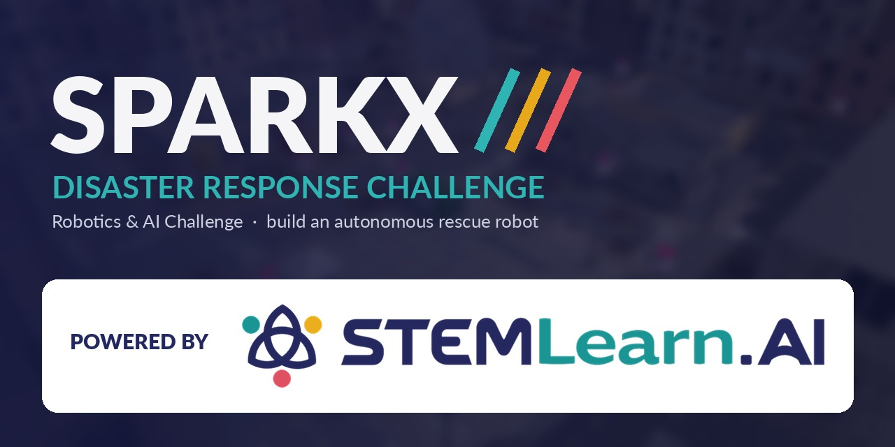
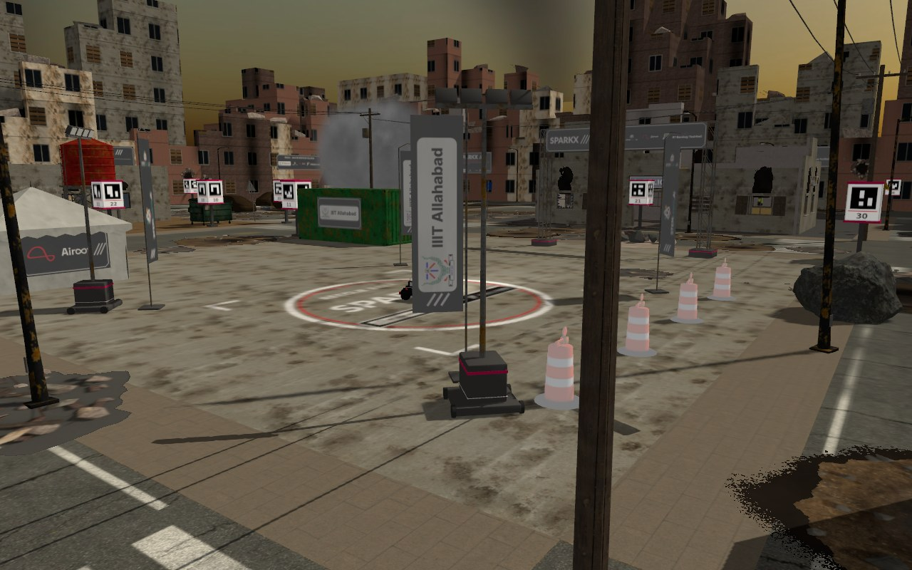
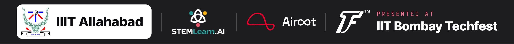

<p align="center"></p>

# SparkX Disaster Response Challenge — Team Kit

**SparkX Robotics & AI Challenge · AI theme · IIIT Allahabad · STEMLearn.AI · Airoot · presented at IIT Bombay Techfest**

This repository is everything your team needs to build, test and hand in your solution: the
simulator (ROS 2 Jazzy + Gazebo Harmonic), the disaster-city worlds, the rescue rover, the referee
that scores you, and four **starter files** that you turn into an autonomous rescue robot.



---

## 1. The goal

A city block has been hit by a blast. Your rover starts on the rescue-base pad. Once the referee
starts the mission, **nobody may touch the controls**. Within the time limit, your software must:

1. **Explore** the block and build a map with the rover's own sensors (no map is given).
2. **Find the survivors**: real people are warm *and* shaped like people. Mannequins are
   people-shaped but cold. In smoky worlds, drums, beams and lockers are heated to body temperature.
   Reporting either one costs you points.
3. **Rescue** each survivor: drive up to them, stop, and report their position to the referee,
   which confirms the rescue.
4. **Follow the clues.** Each rescued person may tell you where someone else is, for example *"about
   15 m west of marker 12"*. Some people cannot be seen from any street; the clues are the only way
   to find them. Numbered markers stand at every junction; your camera has to find and read them.
5. **Stay safe**: avoid fires, rubble and collisions, and handle aftershocks that block streets
   mid-run.
6. **Come home**: return to the base pad, submit your map and mission record, and end the mission.

**What wins:** rescuing everyone, accurately, without penalties, and getting home early. The
competition worlds are generated from secret seeds, so you will not have seen them. A solution
tuned to the practice worlds will not do well. Build something that works on any world.

| World size | Arena | Time limit | Survivors (normal difficulty) |
|---|---|---|---|
| small | ~78 × 78 m | 15 min | 5 |
| medium | ~117 × 82 m | 20 min | 7 |
| large | ~117 × 117 m | 25 min (+5 on hard) | 9 |

## 2. The rules in one minute

Full rules: [`sparkx_ws/docs/RULES.md`](sparkx_ws/docs/RULES.md) (v1.4). The ones that matter most:

> **New in v1.4:** the clue +50 needs your `/team/clues` search area (radius at most 8 m, at most 3
> centre jumps) around the person before the rover could see them; the map score also checks your walls
> and that "free" is drivable ground; false objects in the record cost in full; collisions count per
> obstacle element; the referee flags motion the platform cannot produce. See `sparkx_ws/docs/RULES.md`.

| | |
|---|---|
| **Confirmed rescue** | +100 (+ up to 20 for position accuracy, + 50 if your published clue search area led you there) |
| **To be confirmed** | rover within **2 m** of the person, clear line of sight, **stopped for 2 s**, reported position within **1 m** |
| **Report window** | once you are within 2 m with a clear view, the rescue must be confirmed within **10 s**, or −20 |
| **Return** | `EndMission` inside the 3 m base zone: +100. All rescued *and* home: +5 per full minute left |
| **Map & record** | up to +100 for map quality, up to +50 for the semantic record (landmarks, survivors) |
| **Penalties** | rejected report −25 · collision −10 · touching a survivor −50 · fire −2/s · 60 s without moving 0.5 m −10 · roll-over −100 and the run ends |
| **Disqualified** | touching `/sparkx/referee_private/*` topics, talking to Gazebo directly, reading ground truth from files, any human input during the run |

The final ranking also weighs navigation quality, your trained model, ROS integration, robustness
across worlds, and your documentation and demo (see RULES §7).

**A trained model of your own is required.** It must be more than an unchanged pre-trained
detector, and its output must change what the rover does.

**Your model must run with the official ML kit** (RULES §6): numpy 1.26.4, OpenCV 4.6 (`cv2.ml`) and
`onnxruntime` 1.32.0 on the CPU, nothing else (no PyTorch, Ultralytics, TensorFlow or scikit-learn on
the evaluation machine). Train with any tool you like, then hand the model in at one of three levels:

| Level | Files in `models/` | Runs with |
|---|---|---|
| 1. Plain numbers (recommended) | `.json` `.csv` `.npy` `.npz` | numpy, in a few lines of your own |
| 2. OpenCV model | `.xml` / `.yml` saved by `cv2.ml` | `cv2.ml.<Type>_load()` |
| 3. ONNX | `.onnx` | `onnxruntime` |

**Start with a small classifier** (level 1 or 2): measure a few numbers about each candidate your
sensors find (size, shape, temperature, colour) and let your model decide "person or not". It trains
in seconds, cannot fail to load, and is enough to win. Pickles (`.pt`, `.pkl`, `.joblib`) are not
allowed. Before every scored run the organisers open each model file with the kit: **a model that
does not load is your responsibility, and the run is scored without it.** Check yours with
`python3 sparkx_ws/tools/model_selftest.py` (TEAM_GUIDE §3).

## 3. What you edit: four files, nothing else

```
sparkx_ws/src/sparkx_team/
├── sparkx_team/perception.py   sensors -> detections (your trained model runs here)
├── sparkx_team/memory.py       semantic memory + turning clues into search areas
├── sparkx_team/mission.py      decisions: explore, approach, rescue, follow clues, go home
├── config/team.yaml            every tunable number (your nodes, SLAM, Nav2, EKF)
└── models/                     your trained weights (data files only)
```

The robot, its sensors, the worlds, the referee and all other code are **locked**. Your submission is
these four files plus `models/`. The organisers drop them into an untouched copy of this stack, so a
change you make anywhere else never reaches the competition run.

The starters run as they are, and show every call you need: reading each sensor, placing a pixel on
the map, driving with Nav2 or `/cmd_vel`, and every exchange with the referee. They contain **no
detection and no strategy**. The demo in `mission.py` drives 3 m forward, comes back and ends the
mission.

## 4. Quick start

**You need:** Ubuntu 24.04, 16 GB RAM, a GPU that runs Gazebo (the four sensors are rendered on the
GPU), about 3 GB of disk.

```bash
# 1. ROS 2 Jazzy (https://docs.ros.org/en/jazzy/Installation.html), then:
sudo apt install ros-jazzy-desktop ros-jazzy-ros-gz ros-jazzy-navigation2 ros-jazzy-nav2-bringup \
  ros-jazzy-slam-toolbox ros-jazzy-robot-localization ros-jazzy-pointcloud-to-laserscan \
  ros-jazzy-vision-msgs ros-jazzy-cv-bridge python3-scipy python3-opencv python3-pil
sudo python3 -m pip install --break-system-packages --no-deps onnxruntime==1.32.0   # the official ML kit (RULES §6)

# 2. get the kit and build it
git clone https://github.com/airootinfinity/SparkX_AI_Challenge.git SparkXRelease
cd SparkXRelease/sparkx_ws
source /opt/ros/jazzy/setup.bash
colcon build && source install/setup.bash
python3 tools/sparkx_lock.py verify        # must print "stack integrity: OK"

# 3. run the starter on the small practice world, with the Gazebo window
ros2 launch sparkx_bringup practice.launch.py world:=practice_small_day gui:=true
```

Open the referee's dashboard at **http://127.0.0.1:8080**: mission clock, score, events and a live
map. The starter drives 3 m, returns and ends the mission. If you see that, everything works.

After you change a team file:

```bash
colcon build --packages-select sparkx_team && source install/setup.bash
ros2 launch sparkx_bringup practice.launch.py world:=practice_small_day
```

Every run writes `~/sparkx_logs/<run>/`: `summary.json` (score breakdown, map and localisation
metrics), `events.jsonl`, `reports.jsonl` and your map as an image.

Useful tools:

```bash
ros2 run sparkx_bringup teleop                      # drive by keyboard (practice only)
ros2 run sparkx_sim sensor_check                    # is every sensor alive?
ros2 run sparkx_sim record_mission --out run.mp4    # film a run
ros2 run sparkx_referee leaderboard ~/sparkx_logs   # compare your runs
```

## 5. A path to a good score

Work in this order. Each step is worth points on its own.

| Step | What to build | Why |
|---|---|---|
| 1 | Explore the whole block and come home. End the mission inside the base zone before the time runs out | map score, return bonus, and the basis for everything else |
| 2 | Detect people. Combine the thermal camera (kelvin = pixel × 0.01) with shape and depth, so mannequins and hot objects are rejected. Train your model here | no rescue without detection; false reports cost 25 each |
| 3 | Approach and rescue. Plan a stand-off point outside 2 m, face the person, roll in, stop 2 s, report | the 10 s report window and the 1 m accuracy limit |
| 4 | Semantic memory. Merge repeated detections into single objects; keep landmarks and survivors | semantic score; no duplicate reports |
| 5 | Markers and clues. Read the ArUco markers (`DICT_4X4_100`), remember where they are, and turn each clue into a search area | the people you cannot see from the streets, and +50 each |
| 6 | Robustness: smoky and dusk lighting, blocked streets, aftershocks, getting unstuck, keeping time to return | the secret worlds will test all of it |

Two facts that shape a good search: the LiDAR maps walls out to 30 m, but a person shows up in the
thermal camera only within about 11 m and inside its 57° field of view. A street being on your map
does not mean you have looked down it. And a clue can be used only once your rover has seen the
marker it names.

## 6. Test like the judges

- **Practice world** (answers included in `worlds/<name>/private/`, fine for debugging):

  | World | Size | Difficulty | Lighting | Survivors | Time |
  |---|---|---|---|---|---|
  | `practice_small_day` | small | easy | day | 4 | 15 min |

  This release ships one practice world. More are released later in the event.

- **Make your own worlds.** The competition worlds come from this same generator with secret seeds,
  so testing on fresh seeds is the best predictor of your real score. This is also how you get medium
  and large worlds, smoky and dusk lighting, and hard difficulty to practise on:

  ```bash
  ros2 run sparkx_worlds generate_world --name test_A --seed 1234 --size medium \
      --difficulty normal --lighting smoky --out ~/sparkx_worlds
  ros2 launch sparkx_bringup practice.launch.py world_dir:=$HOME/sparkx_worlds/test_A
  ```

- **Run under competition conditions.** Run headless (no `gui:=true`), let the run go to the end,
  and judge yourself by `summary.json`, not by watching.
- **Short of memory?** Add `textures:=lite` (about 0.4 GB less). Run one simulation at a time. A
  medium world with the Gazebo window needs about 5.5 GB; headless about 2 GB less.

## 7. Hand in

```bash
cd sparkx_ws
python3 tools/sparkx_lock.py pack <team_name>      # -> <team_name>_submission.zip
```

`pack` checks the four files compile and that `models/` holds only data (no code, no sub-folders,
≤ 500 MB per file, ≤ 1.5 GB in total). Run `python3 tools/model_selftest.py` too: it opens every model
exactly as the evaluation does. Upload the zip to the folder the organisers give you. The
file name is your team name on the leaderboard. Your software then runs on the organisers' machine,
on worlds you have not seen, without network access and with an 8 GB memory limit. It cannot read
files outside your own package.

Also hand in your **report** (dataset, training and evaluation of your model, and how your rover
decides) and your **demo**. The organisers announce the deadline and the upload folder.

## 8. Fair play

Everything outside the four files is locked. Practice scores on your own machine are not official.
Only the organisers' run of your zip counts. You are **disqualified on that world** if your code:

- subscribes to or publishes on any `/sparkx/referee_private/*` topic (the referee watches the ROS
  graph every second and ends the run);
- talks to Gazebo directly (`gz` tools, Gazebo transport, your own bridge) or reads ground truth
  from files;
- tries to start, pause or steer the mission, or interferes with the referee;
- is driven or adjusted by a person once the mission is running.

## 9. Documentation

| Document | Read it for |
|---|---|
| [`docs/TEAM_GUIDE.md`](sparkx_ws/docs/TEAM_GUIDE.md) | what each of your files must do, training a model, practising, handing in |
| [`docs/RULES.md`](sparkx_ws/docs/RULES.md) | the complete rules and scoring (v1.4) |
| [`docs/INTERFACES.md`](sparkx_ws/docs/INTERFACES.md) | every topic, service and message you can use |
| [`sparkx_ws/README.md`](sparkx_ws/README.md) | the stack: packages, robot and sensors, worlds |
| [`docs/HOSTING.md`](sparkx_ws/docs/HOSTING.md) | how the organisers run your submission |

## 10. Troubleshooting

| Problem | What to do |
|---|---|
| `stack integrity` is not OK | You changed a locked file. `python3 tools/sparkx_lock.py verify` lists which ones. Restore them with `git checkout -- <file>` |
| The simulator is slow or gets killed | Close other programs, use `textures:=lite`, run headless, one simulation at a time |
| The rover does not move | Commands pass only while the mission is RUNNING, and a command older than 0.5 s stops the rover. Check the dashboard |
| A report is rejected | The `ReportSurvivor` reply says why (`NOT_STOPPED`, `NO_SURVIVOR_IN_RANGE`, `NO_LINE_OF_SIGHT`, `POSITION_MISMATCH`, …) |
| The map score is low | Your `map` frame must start at the start pose. Do not reset or move it |

**Updates.** When this repository is updated, `git pull`. The stack fingerprint printed by
`sparkx_lock.py verify` identifies the release. Keep your own work on a branch, or in a fork, so
updates merge cleanly.

**Questions:** ask the organisers, or open an Issue on this repository.

## Partners

<p align="center"></p>
