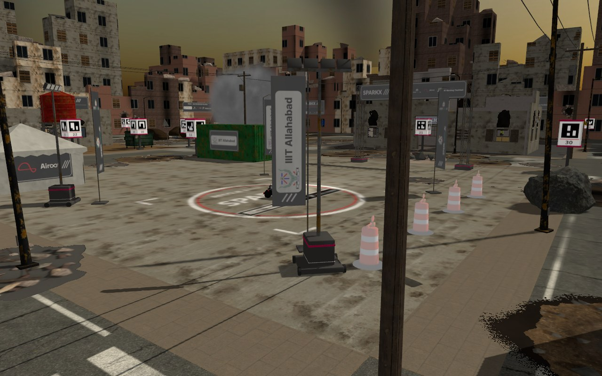
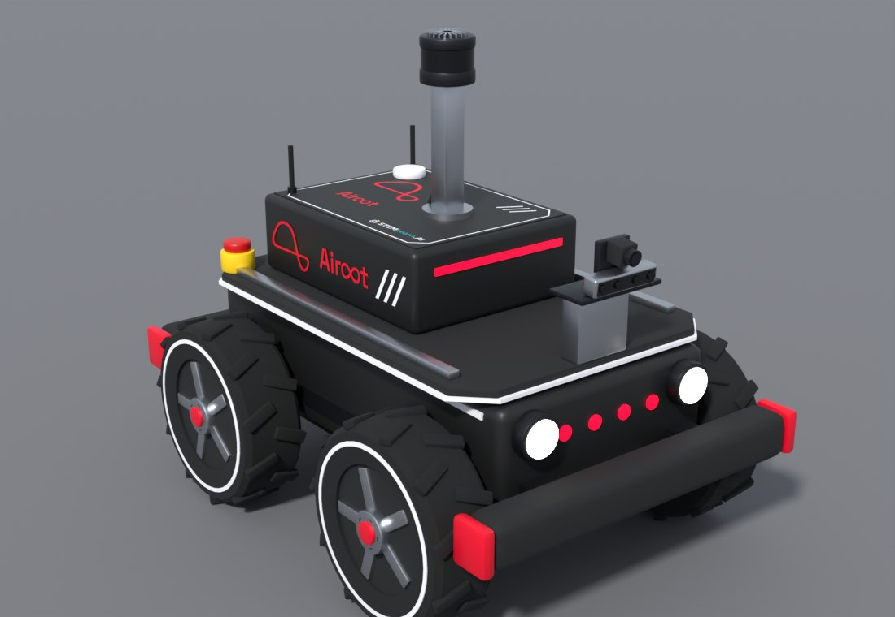

<p align="center"></p>

# SparkX Disaster Response Challenge — Simulation Stack

**IIIT Allahabad · STEMLearn.AI · Airoot · presented at IIT Bombay Techfest.** ROS 2 Jazzy + Gazebo Harmonic stack for the AI theme of the SparkX
Robotics & AI Challenge: a rescue rover explores a bomb-blast city block, finds trapped survivors,
confirms each rescue with the referee, follows the clues that rescued people give, and returns to
base.



| Package | Purpose | Teams may edit |
|---|---|---|
| `sparkx_team` | The team's solution: perception, memory, mission logic, tuning | **yes — 4 files** |
| `sparkx_baseline` | Fixed autonomy plumbing: EKF, scan conversion, SLAM Toolbox, Nav2; loads the team nodes | no |
| `sparkx_interfaces` | Competition API (mission status / events, hints, rescue report, mission record) | no |
| `sparkx_description` | The rover: Husky-class 4WD in Airoot livery, 3D LiDAR, RGB-D, thermal, IMU | no |
| `sparkx_worlds` | Procedural disaster-city generator, Blender-built kit, scanned materials, 4 practice worlds | no |
| `sparkx_sim` | Gazebo launch, spawn, bridges (team topics vs referee-only topics), photo, sensor-check and mission-video tools | no |
| `sparkx_referee` | Mission server: cmd_vel gate, rescue verification, hints, scoring, lock-down checks, dashboard, leaderboard | no |
| `sparkx_bringup` | One-command launch, keyboard teleop, dataset capture | no |

## What a team edits

Exactly four files (plus trained weights in `src/sparkx_team/models/`). The list lives in
[`TEAM_FILES.txt`](TEAM_FILES.txt); everything else is locked and checked.

| File | What goes in it |
|---|---|
| `src/sparkx_team/sparkx_team/perception.py` | Find survivors and landmarks in camera / thermal / depth data; load the team's trained model |
| `src/sparkx_team/sparkx_team/memory.py` | Semantic memory and clue resolution |
| `src/sparkx_team/sparkx_team/mission.py` | Decision making: explore, approach, confirm, follow clues, return |
| `src/sparkx_team/config/team.yaml` | Parameters for the team nodes and for SLAM / Nav2 / EKF |

The four files in this release are starters: they show how to read the sensors, drive and talk to
the referee, and contain no detection and no strategy.
Teams hand in a zip of those files; the organiser loads it into a pristine copy of this stack.
See [`docs/TEAM_GUIDE.md`](docs/TEAM_GUIDE.md) for teams and [`docs/HOSTING.md`](docs/HOSTING.md)
for organisers.

```bash
python3 tools/sparkx_lock.py verify            # has anything locked been changed?
python3 tools/sparkx_lock.py pack <team>       # team: build the submission zip
python3 tools/sparkx_lock.py load <zip> --into <pristine sparkx_ws>   # organiser
python3 tools/sparkx_lock.py manifest          # organiser: re-seal the stack after changing it
```

## Robot



Husky A200-class 4-wheel skid-steer rover, 0.99 × 0.67 m, about 50 kg, 1.0 m/s.

| Sensor | Model class | Spec | ROS topic |
|---|---|---|---|
| 3D LiDAR | Ouster OS1-32 | 32 ch, 360° × 45°, 0.3–60 m, 10 Hz | `/lidar/points` |
| RGB-D | RealSense D455 | 640×480, 87° HFOV, depth 0.3–12 m, 15 Hz | `/camera/color/image_raw`, `/camera/depth/image_raw`, `/camera/depth/points`, `*/camera_info` |
| Thermal | FLIR Boson 320 | 320×256, 57° HFOV, 9 Hz, `mono16`, **kelvin = value × 0.01** (saturates at 653 K) | `/thermal/image_raw`, `/thermal/camera_info` |
| IMU | MEMS 9-DoF | 200 Hz | `/imu/data` |
| Wheel odometry | — | 50 Hz, ~5 % yaw drift | `/wheel/odom` |

Drive with `geometry_msgs/Twist` on `/cmd_vel` (≤ 1.0 m/s, ≤ 1.5 rad/s; commands pass only while the
mission is RUNNING, 0.5 s timeout).

## Install

```bash
sudo apt install ros-jazzy-desktop ros-jazzy-ros-gz ros-jazzy-navigation2 ros-jazzy-nav2-bringup \
  ros-jazzy-slam-toolbox ros-jazzy-robot-localization ros-jazzy-pointcloud-to-laserscan \
  ros-jazzy-vision-msgs ros-jazzy-cv-bridge python3-scipy python3-opencv python3-pil
sudo python3 -m pip install --break-system-packages --no-deps onnxruntime==1.32.0   # with apt's numpy and OpenCV: the official ML kit (RULES §6)
cd sparkx_ws && colcon build && source install/setup.bash
```

Or use Docker: `docker build -t sparkx -f docker/Dockerfile .` (see `docs/HOSTING.md`).

## Run

```bash
# practice run: simulator + referee + the team stack (dashboard on http://127.0.0.1:8080)
ros2 launch sparkx_bringup practice.launch.py world:=practice_small_day gui:=true

ros2 run sparkx_bringup teleop                  # drive by keyboard (practice)
ros2 run sparkx_sim sensor_check                # every sensor alive and not blind?
ros2 run sparkx_sim record_mission --out run.mp4   # film the run: chase view, rover camera, map, score
ros2 run sparkx_referee leaderboard ~/sparkx_logs
```

Practice world: `practice_small_day`. More practice worlds are released later in the event; until then,
generate your own medium and large worlds (see Worlds below).

Add `textures:=lite` on a machine short of memory (half-resolution textures, about 0.4 GB less).

The simulator renders four GPU sensors and needs most of a machine: run one simulation at a time.
On the 15 GB test laptop a small world with the Gazebo window uses about 4 GB and a medium world
with the window about 5.5 GB; headless runs use roughly 2 GB less. Leave that much free, and do not
add photo cameras (`photo`) to a run that is also being filmed.

## Worlds

Competition worlds come from this generator with secret seeds. Teams: generate your own worlds with
any seed to test that your solution works beyond the practice worlds.

```bash
# the same seed always gives the same world
ros2 run sparkx_worlds generate_world --name test_A --seed 1234 --size large --difficulty hard \
    --lighting smoky --out ~/sparkx_worlds
ros2 launch sparkx_bringup practice.launch.py world_dir:=$HOME/sparkx_worlds/test_A
# answers, map and clue chains (on a competition world only the organisers see this)
xdg-open ~/sparkx_worlds/test_A/private/preview.png

ros2 run sparkx_worlds check_generator          # self-test: 36 worlds, every guarantee checked
python3 tools/referee_selfcheck.py --world-dir <world dir>   # live check of rescues, clues, bonuses (uses the answers)
ros2 run sparkx_sim photo --world final_A --out shots base:8,8,7,0.45,0.785    # pictures of a running world
```

Every world is checked before it is accepted: each survivor is reachable and has an approach point
with line of sight, each clue's relation really holds, each clue landmark is unique and visible
from a street, each clue carries a marker reference that points within 2.5 m of its person, every
junction has a numbered marker, people hidden from the streets are clue targets, and there are enough survivors and clues for its size (weak layouts are re-rolled).

## How the look is built

| What | Where | Rebuild |
|---|---|---|
| Rover model, world kit (container, water tower, tent, rubble, window / door sets, furniture, street and base-camp gear) | `tools/blender/` → `sparkx_description/meshes`, `sparkx_worlds/models/sparkx_kit` | see [`tools/blender/README.md`](tools/blender/README.md) |
| Surface materials (scanned brick, plaster, concrete, asphalt, metal; albedo + normal + roughness) | `sparkx_worlds/pbr.py` from Poly Haven CC0 scans | `ros2 run sparkx_worlds make_textures` |
| Partner posters (header order: IIIT Allahabad, STEMLearn.AI, Airoot, IIT Bombay Techfest), start gate, start pad, flags, signs | `sparkx_worlds/branding.py`, artwork in `models/sparkx_media/brand/` | `ros2 run sparkx_worlds make_textures` |
| Bomb damage rendered in Blender and imported as cut-out decals: debris fields, shell craters, shell-holes in walls; the war sky (low sun, haze, ruined skyline) | `tools/blender/render_decals.py` → `models/sparkx_media/textures/decal_*.png`, `sky_war.jpg` | re-render, then `make_textures` |
| Shelled buildings, broken skylines, street debris, soot and cracks | `sparkx_worlds/warzone.py` (applied to every generated world) | regenerate the worlds |
| Vehicles, people, collapsed buildings | Gazebo Fuel models (`models/ATTRIBUTION.md`) | `ros2 run sparkx_worlds import_assets` |

To change the sponsors' artwork, replace a file in `models/sparkx_media/brand/`, run `make_textures`
and regenerate the worlds.

Docs: [`TEAM_GUIDE`](docs/TEAM_GUIDE.md) · [`RULES`](docs/RULES.md) ·
[`INTERFACES`](docs/INTERFACES.md) · [`HOSTING`](docs/HOSTING.md).
